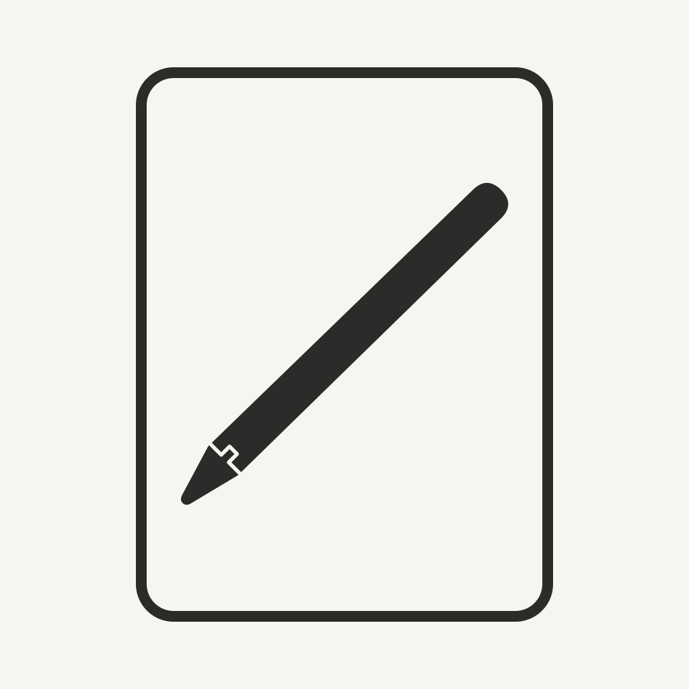
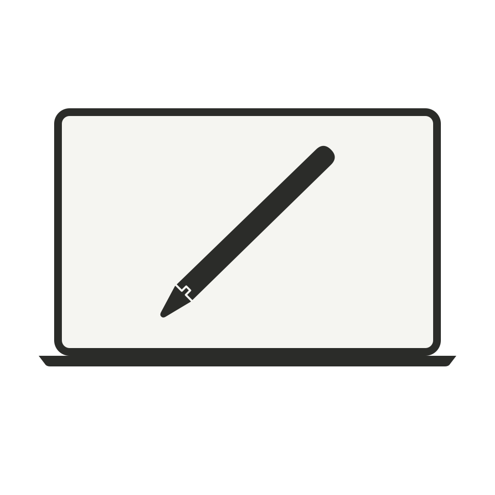
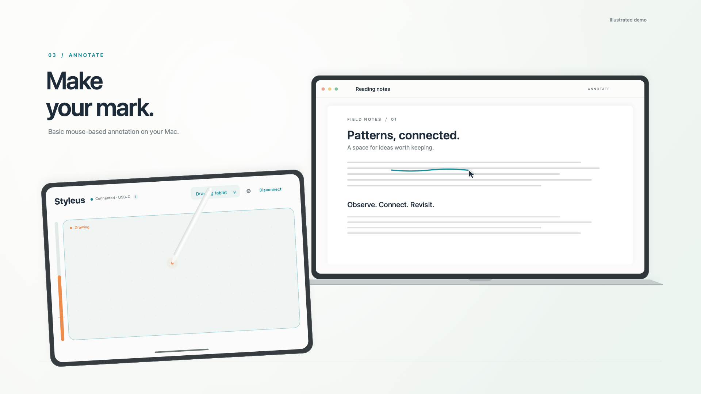

# Styleus

Turn an iPad and Apple Pencil into a Mac trackpad and a basic annotation tablet. Styleus consists of two native Swift apps: an installed iPad app with UIKit Pencil input, and a Mac companion that sends pointer events to your Mac applications.

**Build both apps yourself for free.** You need a Mac, Xcode, an Apple Account, an iPad and a compatible Apple Pencil. A paid Apple Developer Program membership is not required for personal installation. Free iPad signing expires after seven days, so you must periodically rebuild and reinstall. [Apple's Personal Team rules](https://developer.apple.com/help/account/basics/about-your-developer-account/)

<p>
  
  
</p>

[](media/promo/styleus-promo.mp4)

The [product film](media/promo/README.md) is an illustrated interaction demo. The [app icons](media/branding/README.md), animation and quiet original soundtrack are included with reproducible source.

## Start here

Follow **[SETUP.md](SETUP.md)** for the complete first-time workflow:

1. Download the source and open `Styleus.xcodeproj` in Xcode.
2. Configure your own Personal Team and unique bundle identifiers for **both** targets. Keep these settings in the ignored local configuration file.
3. Build the Mac companion and approve Accessibility at its stable app location.
4. Build and install the iPad app on your trusted physical iPad.
5. Pair with the Mac's QR or text code, then connect.

Minimum deployment targets are **iPadOS 17** and **macOS 14**. Your Xcode version must support your iPad's installed OS. The iPad app requires Apple Pencil for pointer movement and clicks; Pencil hover is not required. No third-party Swift package, driver, privileged helper or cloud relay is used.

## What it does

### Trackpad

Pencil movement is relative: lift and reposition without teleporting the pointer. Adjustable sensitivity controls movement speed. Small movement during a tap is ignored so clicking stays steady.

| Action | Gesture |
| --- | --- |
| Move pointer | Slide the Pencil lightly. Lift to reposition. |
| Left click | Tap briefly and lift. |
| Double click | Tap twice quickly in approximately the same place. |
| Right click | Hold still for at least half a second, then lift. |
| Drag | Press more firmly while moving. Ease pressure or lift to release. |
| Scroll | Slide two fingers together vertically or horizontally. |
| Stop scroll glide | Touch down with a finger or the Pencil. |
| Modified click or drag | Hold Command, Shift, Option or Control on the **Mac keyboard** while completing the Pencil gesture. |

One finger does not move or click the pointer. Pencil contact takes priority over scrolling; lift the Pencil and all resting fingers before beginning a new two-finger scroll. Settings provides separate pointer and scrolling sensitivity, independent scroll-direction switches and a pressure activation threshold.

### Basic annotation tablet

Each point in the iPad's active drawing area maps to a fixed point on the selected Mac display or region. Aspect ratio is preserved, with inactive margins. Light contact positions the pointer; firmer pressure starts a stroke. Easing pressure or lifting ends it. Separate strokes do not get joined when you reposition.

**This uses mouse emulation. Pressure determines when the mouse button is held; it does not provide pressure-dependent ink width or tilt to drawing apps.** Select an ink/pen tool in the Mac app, then write while looking at the Mac. Zotero basic annotation has been physically tested. Other applications, including Notability, need their own compatibility checks. See [pressure support](docs/pressure-support.md).

### Compact controls and feedback

The iPad's narrow vertical pressure meter sits at the left edge, outside the movement area. Blue fill shows local pressure, the cross-mark shows the activation threshold, and orange shows an active drag or drawing stroke. It is local input feedback, not confirmation from the receiving Mac app.

Connection status sits beside **Styleus**. Tap **ⓘ** for the full message and relevant troubleshooting steps. Choose USB-C / wired or Wi-Fi under **Settings → Connection**. Disconnect stays visible. The Mac's optional cursor indicator defaults to Off.

## Connection and safety

Pairing uses a private QR or text code. A random pairing secret stays in the apps' local Keychains. Bonjour discovers the paired service and Network.framework provides authenticated, encrypted local communication. There is no cloud relay or internet-facing control service. Keep pairing codes and local diagnostic reports private.

**USB-C / wired is the default.** It uses the IP network interface exposed by a trusted USB data connection; it is not a raw-USB driver. It never silently falls back to Wi-Fi. Cable operation has been tested on development hardware, including with iPad Wi-Fi disabled. Plug-and-play operation on a clean Mac without prior development preparation has **not** been verified. Wi-Fi is available, but can vary with network conditions.

Only one paired, authenticated connection can control the Mac. Disconnects, mode or geometry changes, cancellation, iPad backgrounding and Mac lock/sleep release held input. A short input lease and a watchdog limit stalled connections. Reconnect explicitly; old drags and strokes do not resume. The Mac companion continues while another Mac application is in front, and its menu bar offers **Disconnect and stop**.

## Build, test and renew

After [configuring signing](SETUP.md#2-configure-your-own-signing):

```sh
zsh scripts/build.sh
zsh scripts/test.sh
```

The build script creates the Mac app at `dist/Styleus Mac.app` and compiles unsigned iPad device and simulator builds. **An unsigned device build cannot be installed.** Quit the Mac companion from its menu-bar menu before replacing it. Build logs stay under `build/`.

Use `zsh scripts/build.sh --check-only` to check compilation without replacing the Mac app or quitting an existing copy.

To install or renew the signed iPad app, connect and unlock the iPad, then use the same device identifier or name each time:

```sh
xcrun devicectl list devices
zsh scripts/install-ipad.sh 'YOUR_DEVICE_IDENTIFIER_OR_NAME'
```

Use the same Apple Account, local signing configuration and bundle identifiers for renewal. Do not delete the existing iPad app as a routine renewal step. The full [renewal instructions](SETUP.md#6-renew-the-ipad-app-every-seven-days) cover Xcode and the script.

Tests cover coordinate mapping, input state, protocol/session safety, connection presentation and authenticated transport. They use local test data and loopback sockets rather than your pointer or documents. Builds and tests do not establish physical-device responsiveness or compatibility with every drawing application. See [validation](docs/validation.md) and the [hardware checklist](docs/hardware-checklist.md).

## Project layout

| Folder | Contents |
| --- | --- |
| `iPad/` | SwiftUI controls, UIKit Pencil/touch input, QR scanning and connection lifecycle. |
| `Mac/` | Native setup UI, display/region selection and guarded pointer event output. |
| `Shared/` | Mapping, input state machines, wire protocol, pairing and encrypted transport. |
| `Tests/` | Automated tests for the shared core and transport. |
| `scripts/` | Project generation, local signing setup, builds, testing and iPad installation. |
| `docs/` | Architecture, compatibility notes, validation and a physical hardware checklist. |
| `media/` | Original app-icon artwork and a 30-second illustrated product film, with rendering source. |

`Styleus.xcodeproj` is included. If you add Swift source files, regenerate source membership with `python3 scripts/generate_project.py`. Signing settings belong in the ignored `Config/Local.xcconfig`, not in a public commit.

## License

[MIT](LICENSE), copyright Styleus contributors. You may use, modify and redistribute the source under that license, including commercially. Apple controls device signing and platform permissions independently of the source license.
